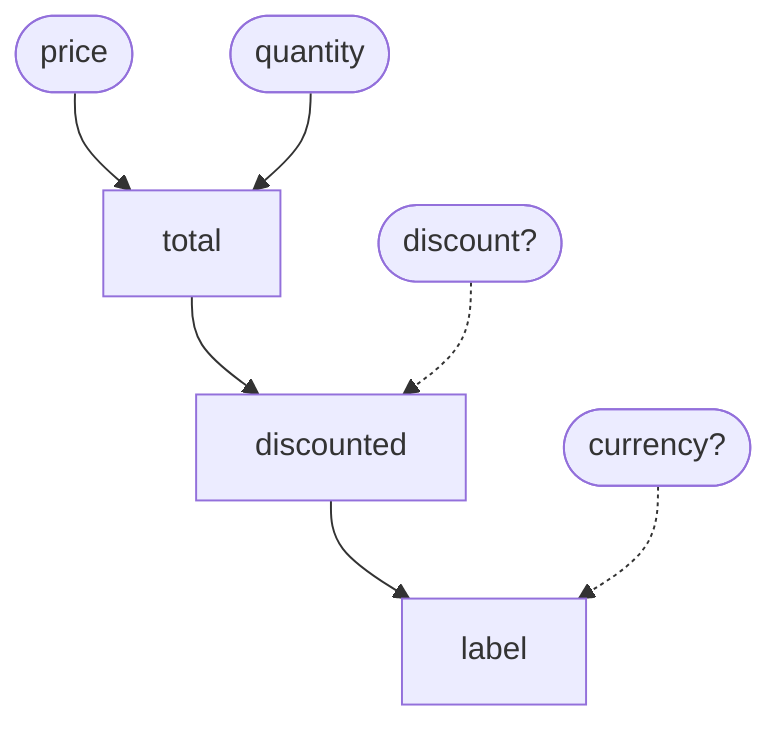

<h1 align="center">fnloom</h1>

<p align="center">
  <strong>Write plain Python functions. Get a fast, strict, deterministic dataflow graph.</strong><br>
  The <a href="https://github.com/apache/hamilton">Apache Hamilton (incubating)</a> model you already know, with the planner and
  executor rebuilt in Rust.
</p>

<p align="center">
  <a href="https://github.com/kelsayed17/fnloom/actions/workflows/ci.yml"></a>
  <a href="https://kelsayed17.github.io/fnloom/"></a>
  
  
  <a href="https://github.com/kelsayed17/fnloom/blob/main/LICENSE"></a>
</p>

<p align="center">
  <a href="https://kelsayed17.github.io/fnloom/"><b>Docs</b></a> ·
  <a href="https://kelsayed17.github.io/fnloom/getting-started/"><b>Get started</b></a> ·
  <a href="https://kelsayed17.github.io/fnloom/from-hamilton/"><b>Coming from Hamilton</b></a> ·
  <a href="https://kelsayed17.github.io/fnloom/benchmarks/"><b>Benchmarks</b></a>
</p>

---

You write a module of ordinary, typed functions. fnloom reads the graph straight from them: **a function's name is a
node, and its parameter names are the edges.** Ask for the outputs you want, and fnloom runs exactly the functions
needed to produce them, in a fixed order, with your mistakes caught before anything runs.

## Highlights

- 🧵 **Your functions are the graph.** No decorators, no registration, no config objects. Delete fnloom tomorrow and
  your code is still plain Python you can call and test directly.
- ⚡ **Up to 24× faster repeat runs than Hamilton.** Compile a request once with `prepare`, then run it as often as you
  like. A 1,000-node graph runs in about 0.2 ms.
- 🛡️ **Mistakes fail loudly, and early.** A misspelled input, a dependency cycle, a type mismatch between two functions
  or an `async def` node raises a clear error naming the culprit. Hamilton accepts several of these silently.
- 🎯 **The same order, every run.** Nodes run in topological order with ties broken by name, so logs and side effects
  never shuffle between runs.
- 🏔️ **No depth limit.** Nothing recurses over the graph, so a 50,000-node chain builds and runs in about 0.6 s. Hamilton
  hits `RecursionError` at around 1,000.
- 🦀 **A Rust core you can embed.** `fnloom-core` has no dependencies and no `unsafe`, and it doesn't care what a node
  runs.

## A graph in one screen

```python
# file: pricing.py
def total(price: float, quantity: int) -> float:
    """What the line costs before any discount."""
    return price * quantity


def discounted(total: float, discount: float = 0.0) -> float:
    """The total after the discount, if one is given."""
    return total * (1 - discount)


def label(discounted: float, currency: str = "EUR") -> str:
    """The price as shown to a customer."""
    return f"{discounted:.2f} {currency}"
```

That module is this graph. `price` and `quantity` aren't the name of any function, so they're inputs. `discount` and
`currency` have defaults, so they're optional:



Build a driver and ask for what you need:

```python
import fnloom
import pricing

driver = fnloom.build(pricing)
driver.execute(["label"], inputs={"price": 2.5, "quantity": 4})
# -> {'label': '10.00 EUR'}

# Running the same request in a loop? Compile it once.
plan = driver.prepare(["label"], inputs={"price": 0.0, "quantity": 0})
plan.run(inputs={"price": 4.0, "quantity": 3})
# -> {'label': '12.00 EUR'}
```

Next, the [guides](https://kelsayed17.github.io/fnloom/writing-nodes/) cover which functions become nodes, overrides,
prepared plans, type checks, lineage and every error message.

## fnloom vs. Hamilton

fnloom uses Hamilton's model, so a module of Hamilton functions is already a module of fnloom nodes. The difference is
in what happens when you run it.

| | Hamilton 1.90.0 | fnloom |
| --- | --- | --- |
| A chain of 1,000+ nodes | `RecursionError` | ✅ Runs at any depth |
| A dependency cycle | `RecursionError` when executed | ✅ `ValueError` naming the cycle, at build |
| A misspelled input or override | Silently ignored | ✅ `ValueError` naming it |
| An `async def` node | The un-awaited coroutine is the value | ✅ `ValueError` at build |
| Execution order | Depends on how you list outputs | ✅ Always the same |
| Running a request again | Re-planned on every call | ✅ `prepare` once, `run` many times |
| Runtime dependencies | numpy, pandas and more | ✅ None |

Hamilton is fnloom's test oracle. Every case runs through both, and every deliberate difference is
[a row in the register](https://kelsayed17.github.io/fnloom/quirk-register/) with a test asserting both sides.
Moving over? Read [Coming from Hamilton](https://kelsayed17.github.io/fnloom/from-hamilton/).

## Performance

Milliseconds on an Apple M2 Pro, lower is better, from the
[full benchmarks](https://kelsayed17.github.io/fnloom/benchmarks/):

| Graph | Build (Hamilton → fnloom) | Repeat run (Hamilton → fnloom) |
| --- | --- | --- |
| 1,000 nodes, layered | 21.6 → **7.2** | 4.35 → **0.21** (21×) |
| 1,000-input fan-in | 3.02 → **1.47** | 2.73 → **0.31** (9×) |
| 10,000-node chain | 207.5 → **63.4** | `RecursionError` → **1.34** |
| 10,000 `@parameterize` rows | 5,285 → **128** | `RecursionError` → **1.35** |

Your node functions still run at Python speed. fnloom removes the overhead around them: planning, validation and
dispatch.

## Is fnloom a good fit?

**Yes, if** you compute many derived values from a few inputs (features, metrics, pricing, signals), want each step
to be a small function you can test on its own, and run the same graph many times in one process.

**Not yet, if** you need Hamilton's adapters, result builders, async execution, `@config.when`, `@extract_columns` or
caching. They're on the [roadmap](#status). fnloom is also not a scheduler. It doesn't retry, distribute or schedule
work, so pair it with an orchestrator if you need that.

## Install

fnloom isn't on PyPI yet. Build it from source with Python 3.14 or newer, [uv](https://docs.astral.sh/uv/) and a
stable Rust toolchain:

```bash
git clone https://github.com/kelsayed17/fnloom.git
cd fnloom
uv sync
uv run maturin develop --release
```

## Status

**Pre-alpha.** Done so far:

- ✅ The Rust core and the native Python path
- ✅ `@parameterize`, `@tag`, graph inspection and type checks
- 📐 Result caching: designed, not yet built
- 🔜 Configuration and `@extract_*`, then adapters and async execution, then visualisation

The [design](https://kelsayed17.github.io/fnloom/design/2026-10-26-fnloom-design/) has the full plan. The name is
provisional, pending a trademark check before the first release.

## Contributing

[CONTRIBUTING.md](CONTRIBUTING.md) covers the setup and the one check script. Please report security problems
privately, as [SECURITY.md](SECURITY.md) describes.

Licensed under [Apache-2.0](LICENSE). Not affiliated with or endorsed by the Apache Software Foundation or the Apache
Hamilton (incubating) project.
