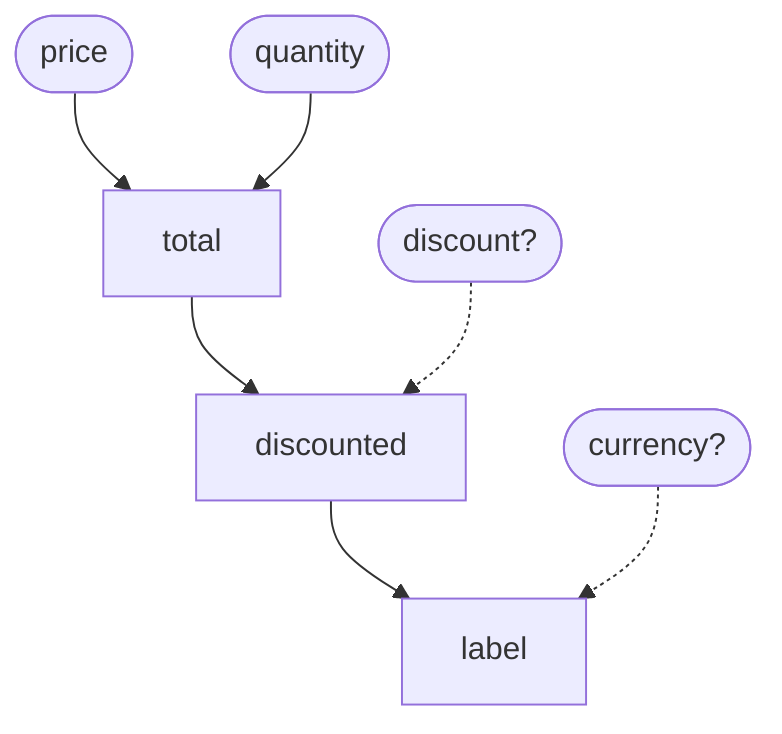

<div class="fl-hero" markdown>

<div markdown>

# fnloom

**Write plain Python functions. Get a fast, strict, deterministic dataflow graph.**
fnloom uses the [Apache Hamilton (incubating)](https://github.com/apache/hamilton) model you may already know, with the planner and
executor rebuilt in Rust.

[Get started](getting-started.md){ .md-button .md-button--primary }
[Coming from Hamilton](from-hamilton.md){ .md-button }
[:fontawesome-brands-github: GitHub](https://github.com/kelsayed17/fnloom){ .md-button }

</div>

</div>

<div class="grid cards" markdown>

-   :lucide-function-square:{ .lg .fl-icon } **Your functions are the graph**

    ---

    A function's name is a node, and its parameter names are the edges. No decorators, no registration, no config
    objects. Your code stays plain Python you can call and test on its own.

    [:lucide-arrow-right: Writing nodes](writing-nodes.md)

-   :lucide-zap:{ .lg .fl-icon } **Up to 24× faster repeat runs on plain graphs**

    ---

    Compile a request once with `prepare`, then run it as often as you like. A 1,000-node graph runs in about
    0.2 ms, where Hamilton takes over 4 ms.

    [:lucide-arrow-right: Running a graph](running.md) · [Benchmarks](benchmarks.md)

-   :lucide-shield-check:{ .lg .fl-icon } **Mistakes fail loudly, and early**

    ---

    A misspelled input, a cycle, a type mismatch or an `async def` node in a sync build raises a clear error naming
    the culprit, before any node runs. Hamilton accepts several of these silently.

    [:lucide-arrow-right: Errors](errors.md)

-   :lucide-list-ordered:{ .lg .fl-icon } **The same order, every run**

    ---

    Nodes run in topological order with ties broken by name, however you list the outputs. Logs and side effects
    never shuffle between runs.

    [:lucide-arrow-right: Execution order](running.md#execution-order)

-   :lucide-infinity:{ .lg .fl-icon } **No depth limit**

    ---

    Nothing recurses over the graph, so a 50,000-node chain builds and runs. Hamilton hits `RecursionError` at
    around 1,000.

    [:lucide-arrow-right: Differences from Hamilton](quirk-register.md)

-   :lucide-cpu:{ .lg .fl-icon } **A Rust core you can embed**

    ---

    `fnloom-core` has no dependencies and no `unsafe`. Its graph, planner and executor don't care what a node
    runs.

    [:lucide-arrow-right: The Rust core](rust-core.md)

</div>

## A graph in one screen

Start with a module of plain functions:

```python
# file: pricing.py
def total(price: float, quantity: int) -> float:
    """What the line costs before any discount."""
    return price * quantity


def discounted(total: float, discount: float = 0.0) -> float:
    """The total after the discount, if one is given."""
    return total * (1 - discount)


def label(discounted: float, currency: str = "EUR") -> str:
    """The price as shown to a customer."""
    return f"{discounted:.2f} {currency}"
```

fnloom reads this graph from it. `price` and `quantity` aren't the name of any function, so they're inputs. `discount`
and `currency` have defaults, so they're optional (dashed):



Build a driver and ask for what you want. Only the functions your outputs need will run:

```python
import fnloom
import pricing

driver = fnloom.build(pricing)
driver.execute(["label"], inputs={"price": 2.5, "quantity": 4})
# -> {'label': '10.00 EUR'}
driver.execute(["label"], inputs={"price": 2.5, "quantity": 4, "discount": 0.1})
# -> {'label': '9.00 EUR'}
```

## Why not just use Hamilton?

fnloom keeps what makes Hamilton pleasant and fixes what bites. A few highlights:

<div class="fl-compare" markdown>

| | Hamilton 1.90.0 | fnloom |
| --- | --- | --- |
| A chain of 1,000+ nodes | `RecursionError` | Runs at any depth |
| A dependency cycle | `RecursionError` when run | `ValueError` naming the cycle |
| A misspelled input | Silently ignored | `ValueError` naming it |
| Execution order | Depends on how you list outputs | Always the same |
| Running a request again | Re-planned every call | `prepare` once, `run` many times |

</div>

Every difference is deliberate and listed in the [register of differences](quirk-register.md), and most are
tested against Hamilton side by side.

!!! note "Status: pre-alpha"

    fnloom isn't on PyPI yet, so [build it from source](getting-started.md). The Rust core, the native Python path,
    `@parameterize`, `@tag`, `@config.when*`, `@extract_fields`, `@extract_columns`, `@exclude`, graph inspection,
    `validate`, graphs from plain functions, namespaces, type checks, [result caching](caching.md), the async driver,
    [hooks](hooks.md), result builders, output checks, custom value checks, [drawing, export and the
    CLI](drawing.md), [output validators](writing-nodes.md#checking-values), [steps](writing-nodes.md#steps),
    `@inject`, `@resolve` and [node wrappers](running.md#node-wrappers) are done. Dynamic execution comes later;
    [the design](design/2026-10-26-fnloom-design.md) has the full plan.
